# KewlRice

This is my Hyprland setup on Arch Linux. Everything is see-through with a soft blur, there are 13 themes that recolor the whole desktop (each with its own wallpaper, sounds and terminal frame), little sounds play when apps open and close, and Alt+Tab shows your open apps sitting on a spinning planet.

## Screenshots

| Desktop | Terminal |
| --- | --- |
|  |  |
| **Launcher** | **Alt+Tab** |
|  |  |
| **Music player and calendar** | **Switching themes** |
| 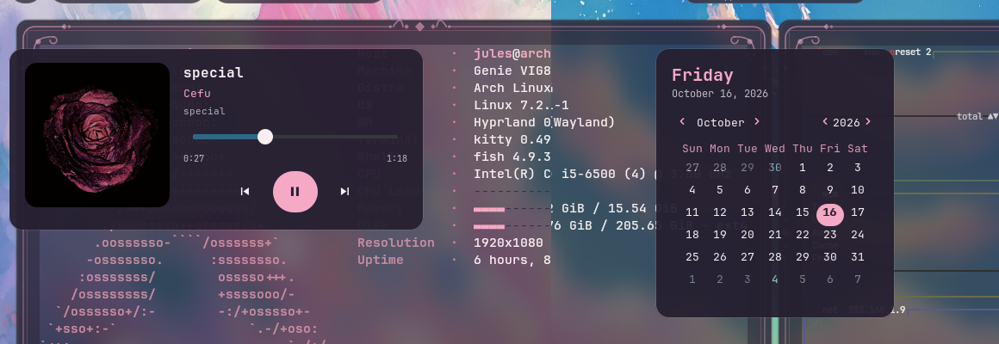 | 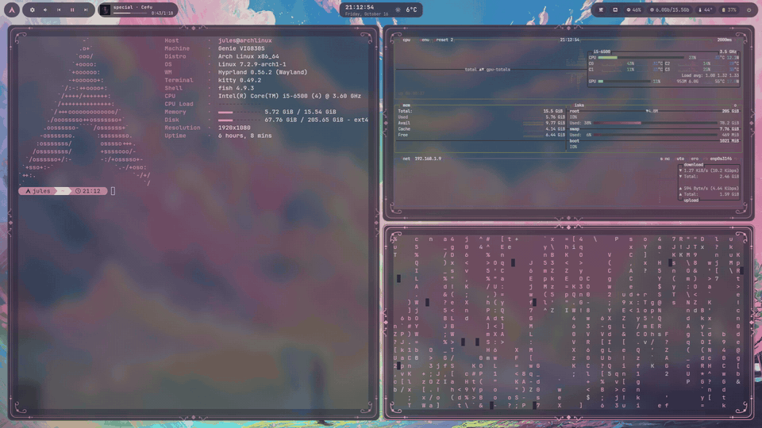 |

These shots are all in the `daydream` theme. Here are all 13 side by side:


| default | burgundy | arctic | slate |
| --- | --- | --- | --- |
| 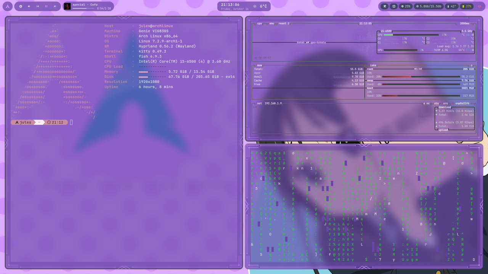 | 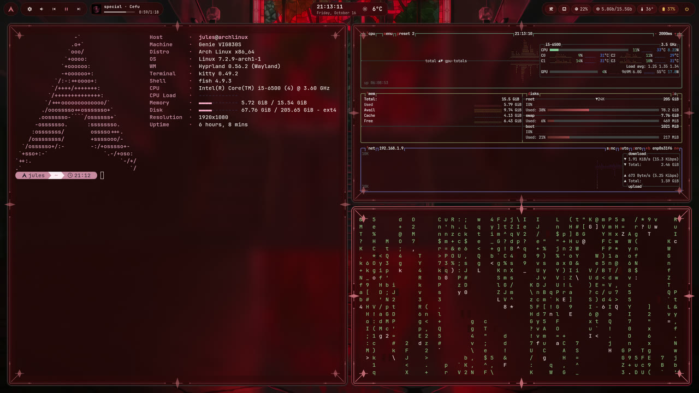 | 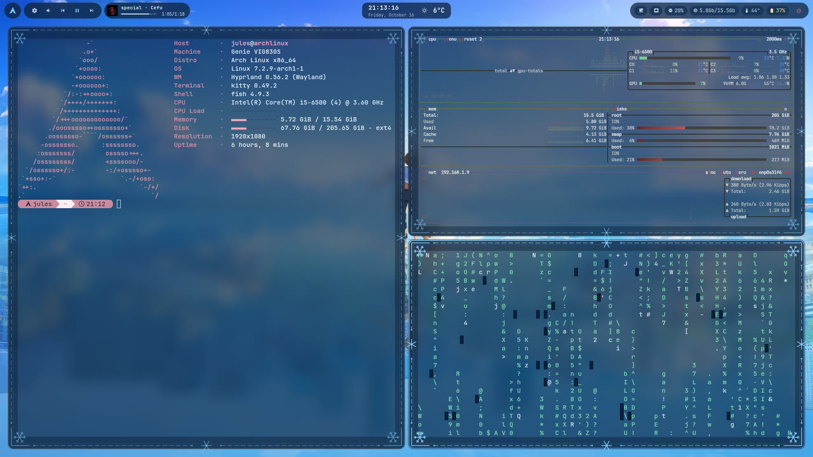 | 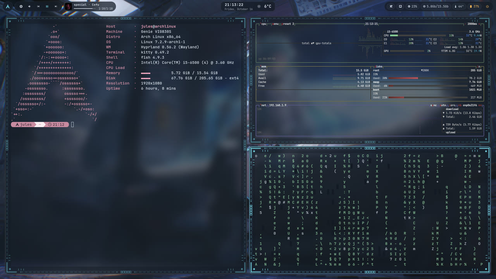 |
| **meadow** | **stardust** | **highland** | **ember** |
| 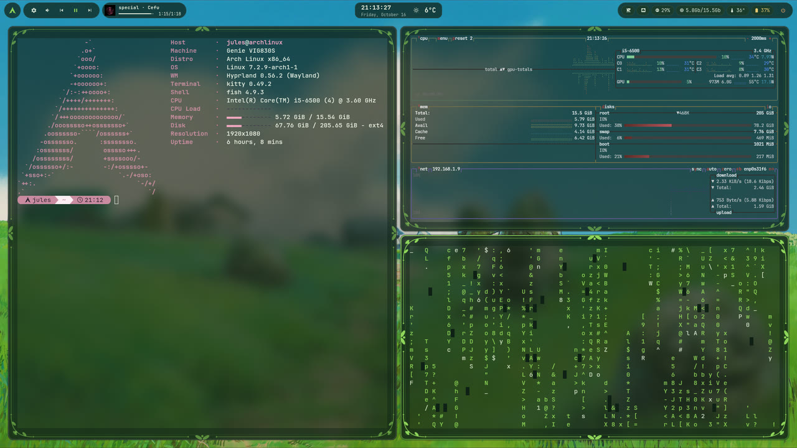 | 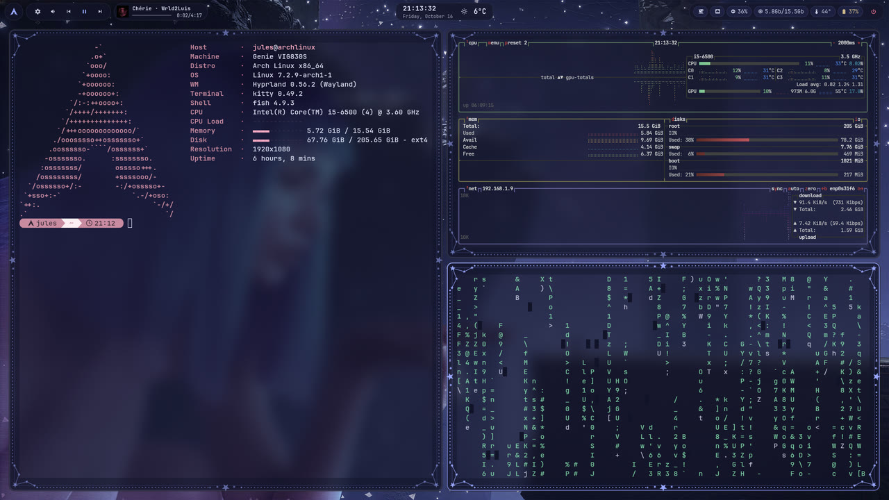 | 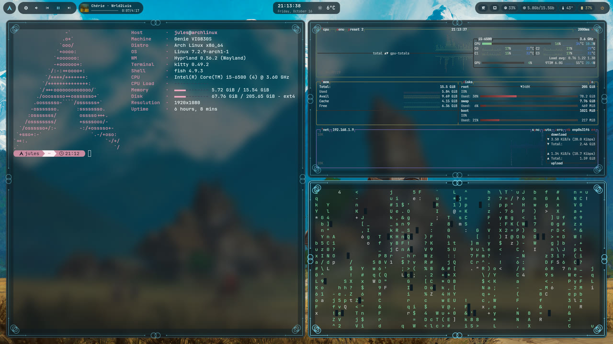 | 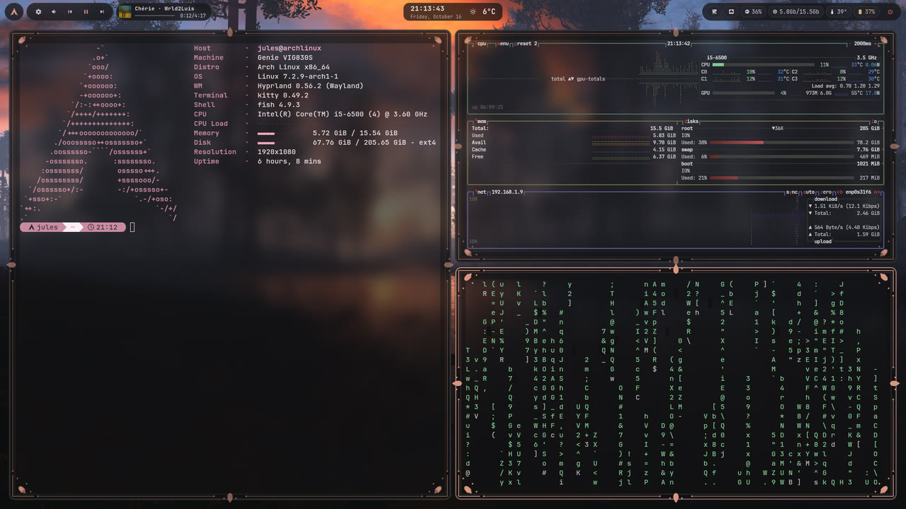 |
| **dusk** | **lilac** | **citypop** | **blush** |
| 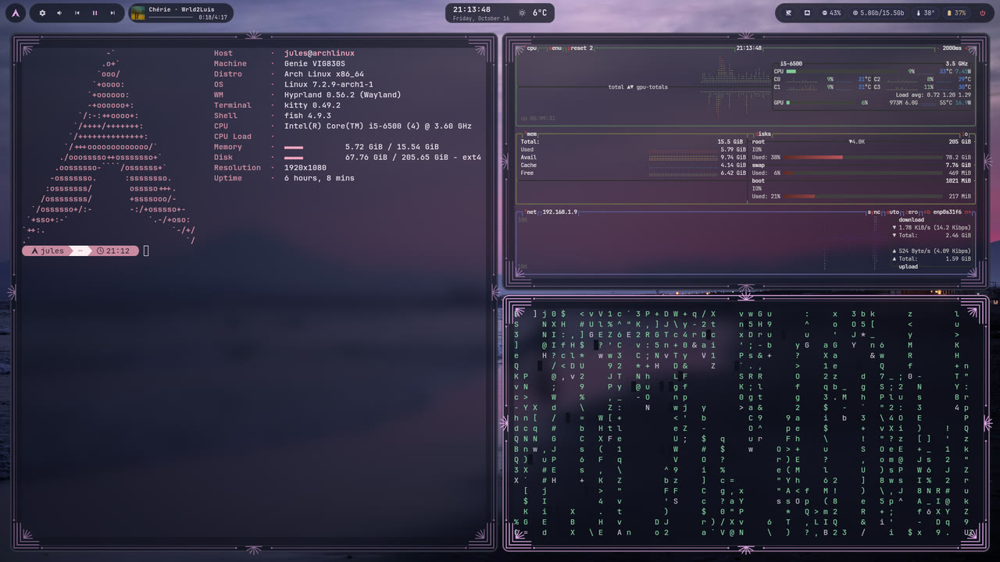 | 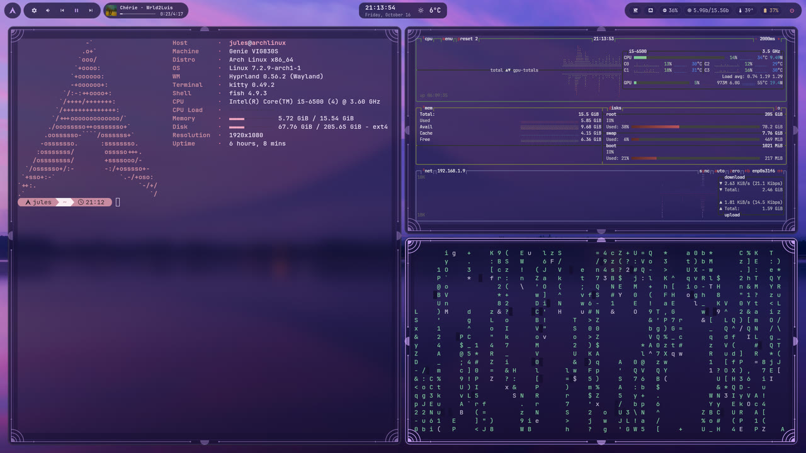 | 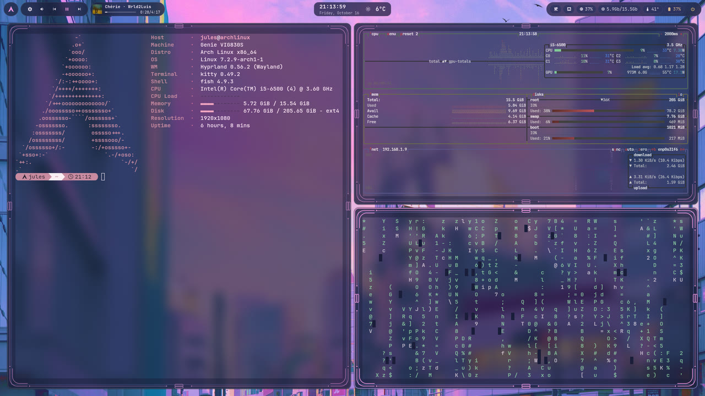 | 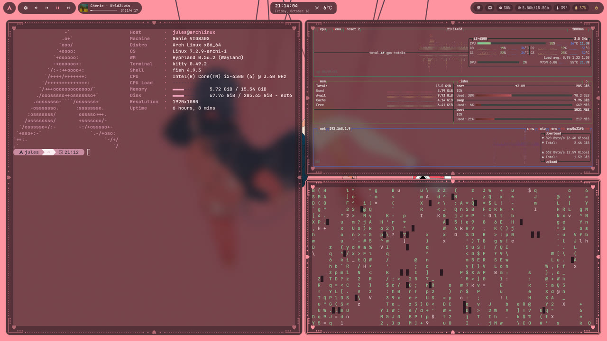 |
| **daydream** | | | |
| 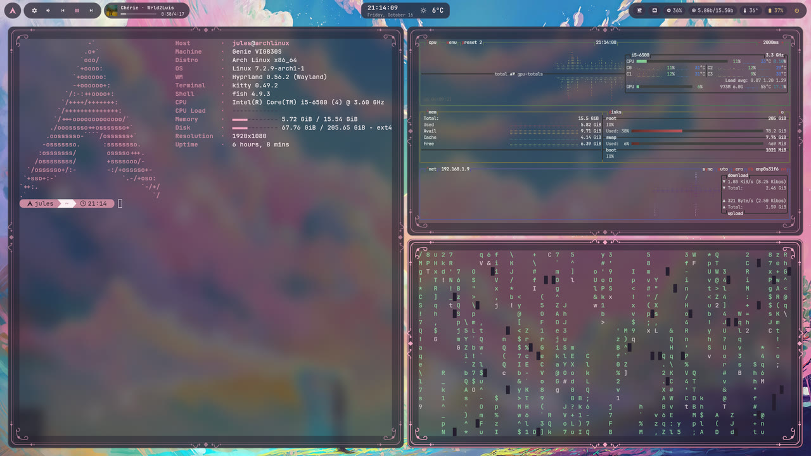 | | | |

Every theme also draws its own frame around terminal windows:

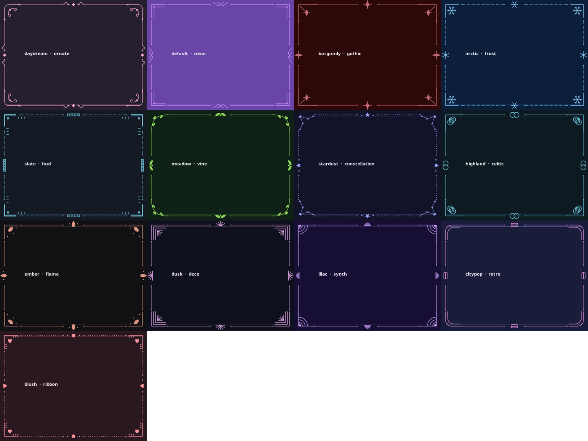

And the Alt+Tab planet looks different in every theme, by day and by night:

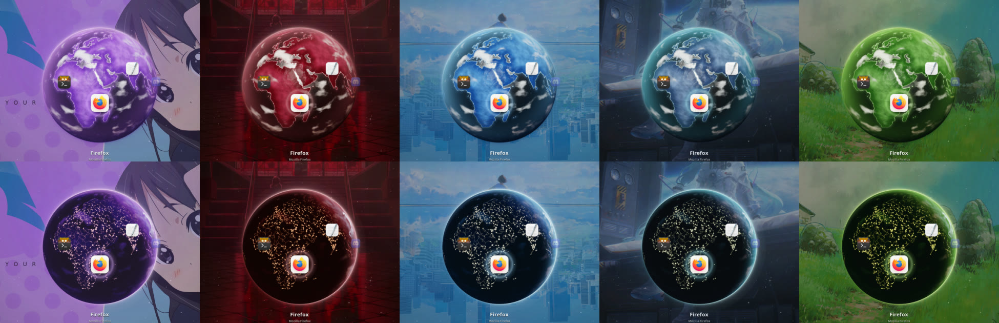

## What you get

- A floating Waybar at the top, made of rounded pills in your theme's colors:
  - Left side: the Arch logo (opens the launcher), control center, volume and media buttons, and a now playing pill with the album cover, song, artist and a progress bar. Click it for a bigger player with the cover, a seek bar and controls
  - Middle: the time with seconds, the date and the weather. Click it for a calendar
  - Right side: tray, network, CPU, RAM in Mb or Gb, temperature, headset battery (turns yellow then red as it runs low) and power
- 13 themes on Super+Tab. Each one changes the colors everywhere, the wallpaper, the sounds and the frame drawn around your terminals. The whole screen sweeps over to the new look with a soft chime
- Every app is see-through at 80%, and new apps you install get it too
- Kitty and Konsole are see-through in your theme's colors, and so are btop and cmatrix. cmatrix rains in your theme's accent color
- A decorated frame around every terminal window, different for each theme (neon, gothic, frost, sci-fi, vines, constellations, celtic, flames, art deco, synthwave, retro, ribbons and an ornate one), even in fullscreen
- A launcher on Super+R (press it again to close it)
- An Alt+Tab switcher where your open apps sit on a glowing Earth in your theme's colors (real coastlines, relief, clouds, shiny oceans and a soft atmosphere) floating in a starfield, with Mac style app icons. Keep tapping Tab and it keeps spinning, forever if you want, and it turns slowly on its own when you wait. The sun follows the real time of day, sunrise and sunset glow orange, and at night the city lights come on. It opens almost instantly
- A clipboard history on Super+V
- A sound when an app opens or goes fullscreen, and another when it closes
- A sound when you log in, its own sound when you open the terminal, and a little click for every key you type in the terminal (with a deeper one for Backspace, and it keeps clicking while you hold a key down). Shortcuts like Alt+Tab stay silent
- Notifications that go away after 5 seconds on their own
- System apps like Settings and the volume mixer are dark and see-through too
- Brave turns solid on YouTube and whenever a video is playing, so videos look sharp
- Discord turns solid while you're watching a video in it, then goes back to see-through once you're done
- Steam, Steam games and Minecraft stay solid, so games look the way they're meant to
- A snipping tool like on Windows, with drawing, blur and crop
- fastfetch with a spinning Arch logo and a spin sound every time you open a terminal or run it
- The fish shell with a pill prompt showing your name, the folder you're in and the time, in the same color as the fastfetch logo
- A French keyboard layout (easy to change, see below)

## What you need

A fresh Arch Linux install with Hyprland already set up (0.56 or newer, since this config uses the new Lua config file and older versions won't work).

Install the packages:

```bash
sudo pacman -S --needed git base-devel waybar wofi rofi kitty konsole dolphin mako wtype pipewire-audio pavucontrol python otf-font-awesome noto-fonts grim wl-clipboard python-cairo python-gobject gtk-layer-shell hyprlock plasma-integration btop cmatrix fastfetch playerctl curl ttf-jetbrains-mono-nerd cliphist wl-clip-persist fish swaybg unzip
```

`base-devel` is there to compile the Alt+Tab globe the first time you switch theme, and `git` is for cloning this repo and the icon theme further down.

## Install

1. Get the files:

```bash
git clone https://gitlab.com/infectedware/KewlRice.git
cd KewlRice
```

Or, if a friend sent you `KewlRice.zip`, save it to your Downloads folder, then unzip it and go into the folder:

```bash
cd ~/Downloads
unzip KewlRice.zip
cd KewlRice
```

Every step below works the same from inside that folder.

2. Back up your old configs first, because the next step replaces them:

```bash
mkdir -p ~/rice-backup
cp -r ~/.config/hypr ~/.config/waybar ~/.config/wofi ~/.config/rofi ~/.config/kitty ~/.config/mako ~/.config/btop ~/.config/fastfetch ~/rice-backup/ 2>/dev/null
cp ~/.bashrc ~/rice-backup/bashrc 2>/dev/null
cp -r ~/.config/fish ~/rice-backup/ 2>/dev/null
```

If you ever want to go back to your old setup, just copy those files back from `~/rice-backup`.

3. Copy everything into place:

```bash
mkdir -p ~/.config/fish ~/.config/kewlrice ~/.config/fastfetch ~/.config/btop ~/.config/hypr ~/.config/waybar ~/.config/wofi ~/.config/rofi ~/.config/kitty ~/.config/mako ~/.local/share/konsole ~/.local/share/applications
cp -r hypr/* ~/.config/hypr/
cp waybar/* ~/.config/waybar/
cp wofi/* ~/.config/wofi/
cp rofi/* ~/.config/rofi/
cp kitty/* ~/.config/kitty/
cp mako/* ~/.config/mako/
cp btop/* ~/.config/btop/
cp fastfetch/* ~/.config/fastfetch/
cp fish/config.fish ~/.config/fish/config.fish
chsh -s /usr/bin/fish
cp konsole/Transparent.colorscheme konsole/Transparent.profile ~/.local/share/konsole/
cp konsole/konsolerc dolphin/dolphinrc ~/.config/
cp applications/snipping-tool.desktop ~/.local/share/applications/
cp -r themes templates ~/.config/kewlrice/
cp -r hypr/sounds ~/.config/kewlrice/sounds
mkdir -p ~/.config/hypr/wallpapers
cp wallpapers/* ~/.config/hypr/wallpapers/
chmod +x ~/.config/hypr/window-switcher/window_switcher.py ~/.config/hypr/window-switcher/ui_daemon.py
chmod +x ~/.config/hypr/snap-layouts/snap_layouts.py
chmod +x ~/.config/hypr/snipping-tool/snipping_tool.py
chmod +x ~/.config/fastfetch/spinning_logo.py
chmod +x ~/.config/waybar/weather.py
chmod +x ~/.config/waybar/memory.sh ~/.config/waybar/now-playing.sh ~/.config/waybar/album-art.sh
chmod +x ~/.config/hypr/popups/popups.py ~/.config/hypr/popups/popup_request.py
chmod +x ~/.config/hypr/window-frame/window_frame.py
chmod +x ~/.config/hypr/brave-video/brave_video.py
chmod +x ~/.config/hypr/launcher.sh ~/.config/hypr/terminal-key-repeat.sh ~/.config/hypr/clipboard/clipboard_menu.py
chmod +x ~/.config/hypr/theme-switch/theme_switch.py ~/.config/hypr/theme-switch/theme_transition.py ~/.config/hypr/lock/*.sh ~/.config/hypr/power-menu/power_menu.py ~/.config/hypr/control-center/control_center.py
~/.config/hypr/theme-switch/theme_switch.py default
```

4. For the Mac style icons in Alt+Tab, install the WhiteSur icons (no sudo needed, they go in `~/.local/share/icons`):

```bash
git clone --depth 1 https://github.com/vinceliuice/WhiteSur-icon-theme.git /tmp/WhiteSur-icon-theme
/tmp/WhiteSur-icon-theme/install.sh -d ~/.local/share/icons
```

Apps that WhiteSur doesn't recognize just get a white Mac style tile around their normal icon.

The Alt+Tab globe is drawn from real map data (public domain, from Natural Earth). Download it once:

```bash
mkdir -p ~/.cache/kewlrice/geodata
curl -Lo ~/.cache/kewlrice/geodata/ne_50m_land.geojson https://raw.githubusercontent.com/nvkelso/natural-earth-vector/master/geojson/ne_50m_land.geojson
curl -Lo ~/.cache/kewlrice/geodata/ne_50m_populated_places_simple.geojson https://raw.githubusercontent.com/nvkelso/natural-earth-vector/master/geojson/ne_50m_populated_places_simple.geojson
```

The globe for each theme gets built in the background the first time you switch to it, which takes a few seconds. It's drawn live by a tiny C program that gets compiled the first time, using the `base-devel` you installed above. Until it's ready, Alt+Tab just shows a plain sphere.

5. For the themed login screen (it follows whatever theme you used last):

```bash
sudo cp -r sddm/kewlrice /usr/share/sddm/themes/
sudo install -d -m 755 -o "$USER" -g "$USER" /var/lib/kewlrice-sddm
printf '[Theme]\nCurrent=kewlrice\n' | sudo tee /etc/sddm.conf.d/30-kewlrice.conf
~/.config/hypr/theme-switch/theme_switch.py "$(cat ~/.local/state/kewlrice/current-theme 2>/dev/null || echo default)"
```

6. Make KDE and Qt apps dark so they match the rest:

```bash
plasma-apply-colorscheme BreezeDark
```

7. Log out and log back in. That's it.

## Keyboard layout

The setup uses a French keyboard. If you want something else, open `~/.config/hypr/hyprland.lua`, find `kb_layout = "fr"` and change `fr` to your layout, for example `us`.

If you also want French on the login screen and in the text consoles:

```bash
sudo localectl set-keymap fr
sudo localectl set-x11-keymap fr
```

## Shortcuts

| Keys | What it does |
|---|---|
| Super + Q | Open the terminal |
| Super + R | Open the app launcher |
| Super + E | Open the file manager |
| Super + C or Alt + F4 | Close the window |
| Super + F or F11 | Fullscreen on and off |
| Alt + Tab | Switch apps, hold Alt and tap Tab to pick one (Shift + Tab or the arrows go back), or click it with the mouse, works in fullscreen games too |
| Super + D | Show the desktop, press again to get your windows back |
| Super + A | Show all your open apps at once, click one to jump to it, works in fullscreen games too |
| Super + Z | Snap layouts, pick a layout and which app goes where |
| Super + Shift + S | Take a snip, then draw on it, blur it or crop it |
| Super + N | Hide the window |
| Super + Shift + N | Show the hidden windows |
| Super + V | Clipboard history, pick something to paste it |
| Super + Shift + V | Make the window float |
| Super + 1 to 0 | Go to a workspace |
| Super + Shift + 1 to 0 | Move the window to a workspace |
| Super + M | Log out of Hyprland |
| Super + Tab | Pick a theme from the wallpaper cards, press it again to close |
| Super + L | Lock the screen |
| Super + Esc | Power menu: lock, log out, restart, shut down |

Click the volume in the bar to change the volume of each app on its own.

After a snip, right click the image to copy it or save it. Nothing gets saved unless you choose Save as. You can also open the Snipping Tool app from the launcher.

In the Super + A view you can hold Super and drag an app with the left mouse button to move it, or with the right button to resize it. When you close the view, the apps you moved stay where you put them.

## Themes

Press Super + Tab to pick a theme. The colors of the borders, bar, launcher, Alt+Tab menu, clipboard, terminal, prompt, cmatrix, notifications, snipping tool and GTK apps all change right away, and so does the wallpaper. Whatever theme you pick stays after a reboot.

You can also switch from a terminal:

```bash
~/.config/hypr/theme-switch/theme_switch.py burgundy
```

13 themes come with the rice, each with its own sounds:

| Theme | Look | Wallpaper in `~/.config/hypr/wallpapers/` |
|---|---|---|
| `default` | the purple look, neon frame | `arch-waifu-purple.png` |
| `burgundy` | deep red, gothic frame | `burgundy-stairs.png` |
| `arctic` | icy blue, snowflake frame, crystal chimes | `arctic-sky.png` |
| `slate` | blue-gray space station, sci-fi frame, sonar sounds | `slate-station.png` |
| `meadow` | green countryside, vine frame, kalimba and birds | `meadow-hills.png` |
| `stardust` | starry indigo, constellation frame, celesta | `stardust.png` |
| `highland` | mountain village, celtic frame, flute and lute | `highland.jpg` |
| `ember` | forest sunset, flame frame, cello and crackling fire | `ember.jpg` |
| `dusk` | pink beach at dusk, art deco frame, electric piano | `dusk.jpg` |
| `lilac` | purple Fuji, synthwave frame, darkwave synths | `lilac.jpg` |
| `citypop` | pink anime city, retro frame, city pop keys | `citypop.jpg` |
| `blush` | soft pink, ribbon and heart frame, kalimba | `blush.jpg` |
| `daydream` | pastel clouds, ornate frame, music box, and its own fastfetch layout | `daydream.jpg` |

These wallpapers are included in `wallpapers/` and get copied into `~/.config/hypr/wallpapers/` during the install steps above. To add a theme of your own, drop a picture there with your theme's name, otherwise it falls back to a plain color.

To add a theme, make a folder in `~/.config/kewlrice/themes/` with two files:

- `palette`, with one `name=#rrggbb` per line. Copy `themes/burgundy/palette` and change the colors. It needs `background`, `foreground`, `surface`, `primary`, `secondary`, `accent`, `urgent`, `border_active`, `border_inactive` and `color0` through `color15` for the terminal.
- `wallpaper.png` (or `.jpg`). You can also point to a picture somewhere else with a `wallpaper=` line in `palette`.
- Optionally `style=` set to one of `plain`, `ornate`, `neon`, `gothic`, `frost`, `hud`, `vine`, `constellation`, `celtic`, `flame`, `deco`, `synth`, `retro` or `ribbon` for the terminal outline, and `terminal_padding=14` to keep text inside it.
- Optionally a `sounds` folder with any of the files from `hypr/sounds` (same names, for example `sounds/login.mp3` or `sounds/keys/terminal-key.wav`). Any sounds you leave out just use the normal ones.

The new theme shows up in the Super + Tab menu right away. The files in `templates/` decide which color goes where in each app.

## Lock screen, power menu and control center

- Super + L locks the screen: your wallpaper blurred, a big clock, the date and whatever song is playing.
- Super + Esc opens the power menu. Log out, restart and shut down all ask you to press a second time so you don't hit them by accident. Each one has its own sound.
- The gear button at the left of the bar opens the control center: volume and microphone, network, do not disturb, the song that's playing with its cover and controls, and lock and power buttons.
- The login screen, the lock screen, the power menu and the control center all follow whatever theme you picked last, on their own.

## Changing things

- How see-through apps are: look for `opacity = "0.8 0.8 0.8"` in `hyprland.lua`. Lower is more see-through.
- How strong the blur is: change `size` in the `blur` part of `hyprland.lua`.
- The app sounds: swap `~/.config/hypr/sounds/app-open.mp3` and `app-close.mp3` for your own sounds with the same names.
- The login and terminal sounds: swap `~/.config/hypr/sounds/login.mp3`, `terminal-open.mp3` and `terminal-ready.mp3`.
- The typing sounds: swap `~/.config/hypr/sounds/keys/terminal-key.wav` and `terminal-backspace.wav`.
- The spin sound: swap `~/.config/hypr/sounds/spin.wav`.
- The theme switch chime: swap `~/.config/hypr/sounds/theme-switch.mp3`.
- Apps that stay solid: add their class to the `negative:` list next to the `opacity` rule in `hyprland.lua`. Run `hyprctl clients` to find an app's class.
- Kitty and Konsole stay out of the see-through rule because they already make only their background see-through on their own, so the text stays sharp.
